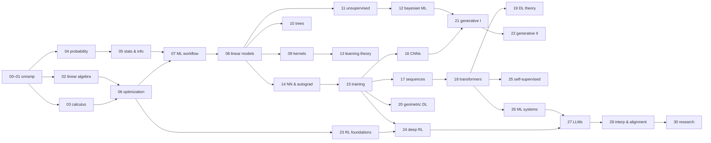

# curriculum map

the complete plan: every chapter, every topic, what you learn, what you build, and what each lab investigates. every topic follows the template in `AUTHORING.md` (lesson → staged exercise + tests → lab → reflection), and every chapter ends with a capstone and a checkpoint.

**size:** 31 chapters · 184 core topics · 29 capstones · 10 electives (pick 2) · 3 research milestones + thesis · roughly 2,500–2,700 hours. at ~13 hours a week that's about four years, the length the README promises.

---

## at a glance

| part | chapters | theme | scaffolding | ≈ hours |
|---|---|---|---|---|
| **0 · onramp** | 00–01 | python, numpy, and the math you need to start (skippable via checkpoint) | L1 | 120 |
| **I · mathematical foundations** | 02–06 | linear algebra, calculus/analysis, probability, statistics & information, optimization | L2 | 450 |
| **II · classical machine learning** | 07–13 | workflow, linear models, kernels, trees, unsupervised, bayesian ML, learning theory | L2→L3 | 500 |
| **III · deep learning** | 14–20 | autograd from scratch, training, CNNs, sequences, transformers, theory, geometric DL | L3→L4 | 550 |
| **IV · generative models** | 21–22 | AR, VAEs, GANs, flows, EBMs, score/diffusion, flow matching | L4 | 200 |
| **V · reinforcement learning** | 23–24 | bandits → tabular → deep RL, model-based, offline | L3→L4 | 200 |
| **VI · modern & frontier ML** | 25–28 | self-supervised & multimodal, ML systems, LLMs, interpretability & alignment | L4 | 350 |
| **VII · electives & research** | 29–30 | ≥2 electives, paper reproduction, thesis | L5 | 300+ |

**research milestones** are spread through the course: **R1** after ch 18 (reproduce a deep learning paper), **R2** after ch 22 (reproduce a generative modeling paper), **R3** after ch 24 (reproduce an RL paper). chapter 30 is the final original project.

## dependency graph

## the `mlfs` library you build

| module | built in | contents |
|---|---|---|
| `mlfs.utils` | 00 | `assert_close`, `set_seed`, plotting helpers |
| `mlfs.linalg` | 02 | LU, QR, eigen (power/QR iteration), SVD, least squares |
| `mlfs.autodiff` | 03 | forward-mode `Dual` numbers, `grad`, `jacobian` |
| `mlfs.random` | 04 | samplers from a uniform source, `MultivariateNormal` |
| `mlfs.stats` | 05 | estimators, `bootstrap_ci`, permutation tests, entropy/KL |
| `mlfs.optim` | 06 | `Optimizer` interface: GD, Momentum, Nesterov, Adam(W), L-BFGS, line search |
| `mlfs.data`, `mlfs.metrics`, `mlfs.model_selection` | 07 | splitters, CV, scalers, pipelines, metrics, search |
| `mlfs.models.*` | 08–13 | linear, kernel, tree, clustering, mixture, HMM, GP, … (one `fit/predict` API) |
| `mlfs.infer` | 12 | MCMC (MH, Gibbs, HMC), VI |
| `mlfs.tensor`, `mlfs.nn` | 14 | reverse-mode autograd `Tensor`, modules, losses, training loop |
| `mlfs.train` | 15 | initializers, norms, schedulers, diagnostics, trainer |
| `mlfs.torch.*` | 15→ | PyTorch implementations of everything from 16 on (build-before-you-use) |
| `mlfs.datasets` | 00→ | cached downloaders for capstone datasets |

---

# part 0 · onramp

## 00 · python & numpy for ML
*goal: write fast, correct, vectorized numerical code and test it.* · L1 · ~50 h

| # | topic | core ideas | you build | lab: you'll find out… |
|---|---|---|---|---|
| 01 | python for numerical work | functions, classes, dunder methods, dataclasses, type hints | a `Vector` class with operator overloading (a preview of `Value`/`Tensor` later) | how much slower pure-python loops are, and why |
| 02 | numpy arrays & vectorization | ndarray, dtypes, shapes, views vs copies, fancy indexing, broadcasting | loop-free pairwise distance matrix; batched ops | the speedup from vectorization across input sizes |
| 03 | floating point & stability | IEEE 754, rounding, cancellation, overflow, log-space tricks | stable `logsumexp`, `softmax`, `sigmoid`, `log1p` usage | how naive softmax breaks with large logits |
| 04 | visualizing data | matplotlib anatomy, histograms, scatter, images, subplots | `plot_decision_boundary`, `image_grid`, `plot_curves` (used all course) | one dataset, four plots, four different stories |
| 05 | testing, debugging & reproducibility | pytest, assertions, seeds, git basics, debugging workflow | `assert_close` with informative diffs, `set_seed` | tests catch a planted bug that eyeballing misses |

**capstone:** *image filters from scratch*: blur, sharpen, and edge detection with vectorized 2D convolution on real photos. (this comes back in ch 16.)

## 01 · math onramp
*goal: the precalculus, calculus, and probability needed for part I, learned by computing.* · L1 · ~70 h

| # | topic | core ideas | you build | lab: you'll find out… |
|---|---|---|---|---|
| 01 | functions, exponents & logs | composition, inverses, exp/log identities, growth rates | `exp` and `log` from series and Newton's method | how many series terms 1e-10 accuracy takes |
| 02 | derivatives | limits, slope, product/chain rules | forward/central finite differences; a derivative checker | why error vs step size is U-shaped (truncation vs rounding) |
| 03 | integrals | riemann sums, fundamental theorem | trapezoid & simpson integrators | each method's convergence rate |
| 04 | vectors & matrices, a first look | dot products, norms, matrices as transformations | a 2D transformation visualizer | what a matrix does to the unit circle |
| 05 | probability by simulation | counting, events, distributions, expectation | monte carlo estimators with error bars | why error shrinks like 1/√n |
| 06 | your first ML model | squared error, gradient of a 1D loss, gradient descent | 1D linear regression with hand-derived GD | what too-small, good, and too-large learning rates look like |

**capstone:** *predict house prices* with a hand-derived multivariate GD, a loss curve, and a comparison with the closed-form answer.

---

# part I · mathematical foundations

## 02 · linear algebra
*goal: think geometrically about matrices and build the numerical linear algebra ML rests on.* · L2 · ~110 h

| # | topic | core ideas | you build | lab: you'll find out… |
|---|---|---|---|---|
| 01 | vector spaces | span, basis, independence, dimension, subspaces | rank via row reduction; basis checker | random high-dimensional vectors are nearly orthogonal |
| 02 | linear maps & matmul | composition, kernel/image, rank–nullity, four views of matmul | matmul three ways; benchmark against BLAS | why `np.matmul` is ~1000× faster than your loops |
| 03 | solving linear systems | gaussian elimination, pivoting, LU, triangular solves | LU with partial pivoting; `lu_solve` | which matrices break elimination without pivoting |
| 04 | orthogonality & least squares | projections, gram–schmidt, QR, normal equations | modified gram–schmidt, householder QR, `lstsq` | classical GS loses orthogonality, modified GS doesn't |
| 05 | eigenvalues & eigenvectors | diagonalization, spectral theorem, power & QR iteration | power/inverse iteration, unshifted QR algorithm | PageRank on a small web graph |
| 06 | SVD & low-rank approximation | SVD geometry, eckart–young, pseudoinverse, PCA-as-SVD | truncated SVD; pseudoinverse | image compression quality vs rank |
| 07 | matrix calculus | gradients w.r.t. vectors/matrices, trace tricks, jacobians | 10 hand-derived gradients checked numerically | your derivation of ∇‖Ax−b‖² matches finite differences |
| 08 | conditioning & stability | matrix norms, condition numbers, backward stability | condition-number estimator | hilbert systems lose digits as the condition number grows |

**capstone:** *eigenfaces*: face recognition with PCA, using only `mlfs.linalg`.

## 03 · calculus & analysis
*goal: multivariable calculus, approximation, and enough analysis to reason about convergence and smoothness.* · L2 · ~90 h

| # | topic | core ideas | you build | lab: you'll find out… |
|---|---|---|---|---|
| 01 | sequences, limits & convergence | ε–δ, cauchy sequences, convergence rates | empirical convergence-rate estimator | bisection is linear, newton is quadratic |
| 02 | multivariable calculus | partials, gradients, directional derivatives, jacobians, hessians | numerical `grad`, `jacobian`, `hessian` | gradients are perpendicular to level sets |
| 03 | taylor approximation | taylor's theorem, remainders, quadratic models | multivariate taylor approximator | where the quadratic model stops being trustworthy |
| 04 | forward-mode autodiff | dual numbers, chain rule as computation | `Dual` class + `grad` (→ `mlfs.autodiff`) | forward mode costs O(inputs), which motivates reverse mode |
| 05 | smoothness & lipschitz continuity | lipschitz constants, L-smoothness, strong convexity preview | empirical lipschitz estimator | estimated L predicts the largest stable step size |
| 06 | integration & change of variables | multiple integrals, jacobian determinants, monte carlo integration | density transform under invertible maps | a transformed gaussian still integrates to 1 (this sets up flows, ch 21) |
| 07 | function spaces | normed/inner-product spaces, hilbert spaces, orthogonal bases | fourier & legendre projections of functions | the gibbs phenomenon |
| ★ | *advanced track (optional)* | real analysis rigor, measure theory, lebesgue integration | proofs, not code | |

**capstone:** *an autodiff-powered newton solver*: root finding and minimization with your forward-mode library, plus convergence analysis.

## 04 · probability
*goal: reason about uncertainty, sample from anything, and understand the limit theorems.* · L2 · ~90 h

| # | topic | core ideas | you build | lab: you'll find out… |
|---|---|---|---|---|
| 01 | probability & random variables | axioms, conditioning, independence, bayes' rule | discrete distribution objects (add, condition, marginalize) | the base-rate fallacy, and monty hall, by simulation |
| 02 | distributions & sampling | common families; inverse-CDF, box–muller, rejection sampling | `mlfs.random` built only from a uniform source | your samplers match numpy's on QQ plots |
| 03 | expectation, variance & covariance | linearity, LOTUS, covariance matrices | welford online mean/variance; covariance estimator | the textbook variance formula fails catastrophically in floating point |
| 04 | the multivariate gaussian | density, marginals, conditionals, cholesky sampling | `MultivariateNormal` (sample / logpdf / condition / marginal) | conditioning a gaussian is slicing it |
| 05 | limit theorems | LLN, CLT, modes of convergence | CLT simulator | the CLT fails for the cauchy distribution |
| 06 | concentration inequalities | markov, chebyshev, hoeffding, bernstein | bound calculators vs empirical tails | how loose each bound is in practice |
| 07 | markov chains & stochastic processes | transition matrices, stationarity, mixing, random walks, brownian motion | chain simulator, stationary-distribution solver, brownian sampler | mixing time tracks the spectral gap |
| ★ | *advanced track* | measure-theoretic probability, martingales | proofs + simulations | |

**capstone:** *n-gram text generator* with perplexity evaluation (an early look at language models, ch 17).

## 05 · statistics & information theory
*goal: estimate, quantify uncertainty, test hypotheses honestly, and measure information.* · L2 · ~70 h

| # | topic | core ideas | you build | lab: you'll find out… |
|---|---|---|---|---|
| 01 | estimation | bias, variance, MSE, consistency | an estimator-evaluation harness | a biased estimator can have lower MSE |
| 02 | maximum likelihood & MAP | likelihoods, conjugate priors, posteriors | MLEs for common families; beta–bernoulli updating | how prior strength trades off against data size |
| 03 | confidence intervals & the bootstrap | sampling distributions, CIs, resampling | `bootstrap_ci` (percentile + BCa) | actual coverage vs nominal coverage |
| 04 | hypothesis testing | p-values, power, permutation tests, multiple comparisons | permutation test; bonferroni & benjamini–hochberg | a p-hacking simulator "discovers" effects in noise |
| 05 | information theory | entropy, cross-entropy, KL, mutual information | info measures (discrete + gaussian); huffman coder | compression rate approaches entropy |
| 06 | exponential families & fisher information | sufficient statistics, natural parameters, cramér–rao | generic exponential-family MLE | estimator variance hits the cramér–rao bound |

**capstone:** *model-comparison toolkit*: compare two classifiers with bootstrap CIs and permutation tests (→ `mlfs.stats`, used for every evaluation from here on).

## 06 · optimization
*goal: understand why and how fast optimizers converge, and build the optimizer library you'll train everything with.* · L2 · ~90 h

| # | topic | core ideas | you build | lab: you'll find out… |
|---|---|---|---|---|
| 01 | convex sets & functions | definitions, 1st/2nd-order conditions, convexity-preserving operations | numerical convexity checker | which common ML losses are convex |
| 02 | gradient descent | convergence rates (smooth / strongly convex), armijo line search | GD with backtracking | condition number causes zig-zagging |
| 03 | momentum & acceleration | heavy ball, nesterov, lower bounds | momentum + nesterov | the race on an ill-conditioned quadratic |
| 04 | stochastic optimization | SGD, minibatch noise, schedules, adagrad / RMSProp / adam(W) | `mlfs.optim` with a shared `Optimizer` interface | when adam beats SGD, and when it doesn't |
| 05 | second-order methods | newton, damping, BFGS, L-BFGS two-loop recursion | newton + L-BFGS | iterations vs wall-clock tradeoffs |
| 06 | constraints & duality | lagrangians, KKT, duality, projected gradient | simplex/ball projections; small QP via KKT | strong duality holds numerically (sets up SVMs) |
| 07 | nonconvex optimization | saddles, local minima, escaping, landscape slices | perturbed GD; 2D loss-landscape slicer | where GD gets stuck on rastrigin and rosenbrock |

**capstone:** *optimizer benchmark suite*: every optimizer on standard test functions and logistic regression, with a convergence report.

---

# part II · classical machine learning

## 07 · the machine learning workflow
*goal: set up learning problems correctly and evaluate them without fooling yourself.* · L2 · ~60 h

| # | topic | core ideas | you build | lab: you'll find out… |
|---|---|---|---|---|
| 01 | what is learning? | supervised/unsupervised, hypothesis classes, losses, ERM | the `Estimator` API (`fit` / `predict` / `score`) | a lookup table memorizes perfectly and generalizes terribly |
| 02 | splitting & cross-validation | train/val/test, k-fold, stratified, grouped, time-series | splitters + `cross_validate` | preprocessing before splitting leaks and inflates scores |
| 03 | metrics | precision/recall/F1, ROC/PR-AUC, log loss, regression metrics, calibration | `mlfs.metrics` incl. ROC curve + reliability diagram | 99% accuracy can be worthless on imbalanced data |
| 04 | bias–variance & complexity | decomposition, under/overfitting, learning curves | resampling-based bias–variance estimator | sweeping polynomial degree |
| 05 | features & preprocessing | scaling, encoding, missing values, pipelines | `StandardScaler`, `OneHotEncoder`, `Pipeline` | kNN with vs without scaling |
| 06 | hyperparameter search | grid, random, nested CV | grid + random search over CV | random beats grid when few hyperparameters matter |

**capstone:** *end-to-end tabular project* with baselines, CV, CIs, and an honest evaluation report.

## 08 · linear models
*goal: master the models everything else is compared against.* · L2→L3 · ~70 h

| # | topic | core ideas | you build | lab: you'll find out… |
|---|---|---|---|---|
| 01 | linear regression | normal equations, GD, gaussian-noise MLE, basis expansions | `LinearRegression` (normal eq / QR / GD solvers) | polynomial bases overfit |
| 02 | regularization | ridge (closed form + bayesian view), lasso (coordinate descent), elastic net | `Ridge`, `Lasso` with regularization paths | lasso paths produce sparsity |
| 03 | the perceptron | decision boundaries, perceptron convergence theorem | perceptron + averaged perceptron | how it behaves on non-separable data |
| 04 | logistic regression | sigmoid, cross-entropy, convexity, IRLS/newton | `LogisticRegression` (GD + IRLS) | separable data makes weights diverge; regularization fixes it |
| 05 | softmax regression | multiclass, softmax/cross-entropy gradients | `SoftmaxRegression` | how far a linear model gets on MNIST |
| 06 | generalized linear models | link functions, exponential families, poisson regression | generic GLM via IRLS | modeling count data |

**capstone:** *text classifier from raw text*: tokenizer, bag-of-words/TF-IDF, logistic regression, error analysis.

## 09 · nonparametric & kernel methods
*goal: learn functions without fixing their form, and understand the kernel trick.* · L3 · ~75 h

| # | topic | core ideas | you build | lab: you'll find out… |
|---|---|---|---|---|
| 01 | k-nearest neighbors | metrics, curse of dimensionality, KD-trees | kNN + KD-tree | distances concentrate in high dimensions |
| 02 | density estimation | histograms, KDE, bandwidth selection | KDE with CV bandwidth | the bandwidth bias–variance tradeoff |
| 03 | kernels & RKHS | feature maps, mercer, representer theorem | kernel library + gram matrices + PSD checks | explicit features vs implicit kernels, cost-wise |
| 04 | support vector machines | max margin, hinge loss, the dual, SMO | kernel SVM via SMO | sweeping C and γ, visualized |
| 05 | kernel ridge & random features | closed-form KRR, nyström, random fourier features | KRR + RFF | approximation quality vs number of features |
| 06 | gaussian processes | GP prior/posterior, marginal likelihood, kernel learning | GP regression with hyperparameter optimization | prior and posterior samples under different kernels |

**capstone:** *bayesian optimization*: GP + expected improvement to tune a model's hyperparameters.

## 10 · trees & ensembles
*goal: build the models that still win on tabular data.* · L3 · ~65 h

| # | topic | core ideas | you build | lab: you'll find out… |
|---|---|---|---|---|
| 01 | decision trees | impurity, CART, pruning | CART classifier + regressor | depth vs overfitting |
| 02 | bagging & random forests | bootstrap aggregation, feature subsampling, OOB error | `RandomForest` with OOB estimates | variance falls as trees are added |
| 03 | boosting | adaboost, exponential loss, margins | adaboost with stumps | margins keep growing after training error hits zero |
| 04 | gradient boosting | functional gradient descent, 2nd-order splits, histograms, shrinkage | `GradientBoosting` (XGBoost-style) | learning rate vs number of trees |
| 05 | interpreting models | permutation importance, partial dependence, shapley values | permutation importance + KernelSHAP | impurity importance is biased toward high-cardinality features |

**capstone:** *tabular benchmark*: get within a stated margin of sklearn's `HistGradientBoosting` with your implementation.

## 11 · unsupervised learning
*goal: find structure without labels.* · L3 · ~70 h

| # | topic | core ideas | you build | lab: you'll find out… |
|---|---|---|---|---|
| 01 | k-means | lloyd's algorithm, k-means++, choosing k | `KMeans` + k-means++ | it fails on non-convex clusters |
| 02 | gaussian mixtures & EM | latent variables, EM derivation, ELBO preview | `GaussianMixture` via EM | likelihood rises monotonically, but local optima remain |
| 03 | dimensionality reduction | PCA revisited, probabilistic PCA, kernel PCA | `PCA`, `KernelPCA` | explained variance vs reconstruction |
| 04 | manifold learning | MDS, isomap, t-SNE | t-SNE from scratch | perplexity effects, and why t-SNE distances mislead |
| 05 | graph & density clustering | spectral clustering, DBSCAN, hierarchical clustering | spectral clustering + DBSCAN | every method on "two moons" |
| 06 | anomaly detection | density scores, isolation forests | `IsolationForest` | sensitivity to the contamination rate |

**capstone:** *exploring unlabeled data*: cluster and embed MNIST without labels, then measure how well the structure matches the true labels.

## 12 · probabilistic & bayesian ML
*goal: model uncertainty explicitly and do inference exactly, by sampling, and by optimization.* · L3 · ~85 h

| # | topic | core ideas | you build | lab: you'll find out… |
|---|---|---|---|---|
| 01 | bayesian linear regression | posteriors, predictive distributions, evidence | `BayesianLinearRegression` | uncertainty grows away from the data |
| 02 | graphical models | bayes nets, MRFs, d-separation, factor graphs | factor graphs + d-separation checker | explaining away |
| 03 | exact inference | variable elimination, belief propagation | VE + sum-product on trees | elimination order changes the cost dramatically |
| 04 | hidden markov models | forward–backward, viterbi, baum–welch | `HMM` with all three | decoding the dishonest casino |
| 05 | MCMC | metropolis–hastings, gibbs, R-hat, ESS | MH + gibbs + diagnostics (→ `mlfs.infer`) | proposal scale vs acceptance vs mixing |
| 06 | hamiltonian monte carlo | hamiltonian dynamics, leapfrog, NUTS idea | HMC using `mlfs.autodiff` | HMC vs MH on a correlated gaussian |
| 07 | variational inference | ELBO, mean-field, CAVI, reparameterization, SVI | CAVI for a GMM; reparameterized VI | VI underestimates variance (the direction of KL matters) |

**capstone:** *a tiny probabilistic programming library*: declare a model, run HMC or VI, summarize posteriors; apply it to the hierarchical "eight schools" model.

## 13 · learning theory
*goal: understand when and why learning from finite data works, and where the theory stops.* · L3 · ~75 h

| # | topic | core ideas | you build | lab: you'll find out… |
|---|---|---|---|---|
| 01 | PAC learning | realizable PAC, finite classes, sample complexity | sample-complexity calculator | theoretical vs empirical sample complexity for thresholds |
| 02 | VC dimension | shattering, growth function, sauer's lemma, the fundamental theorem | brute-force shattering checker | the VC dimension of intervals, rectangles, and 2D halfspaces |
| 03 | rademacher complexity | empirical rademacher, data-dependent bounds | monte carlo rademacher estimator | complexity vs norm constraints |
| 04 | bounds in practice | computing bounds, vacuousness | bounds for your part II models | bound vs real test error |
| 05 | online learning | regret, experts, hedge, online gradient descent | hedge + OGD | regret grows like √T |
| 06 | stability, margins & PAC-Bayes | algorithmic stability, margin bounds, PAC-Bayes | PAC-Bayes bound for a stochastic linear classifier | a non-vacuous bound, actually computed |

**capstone:** *generalization report*: theoretical bounds vs empirical gaps for three models, written up.

---

# part III · deep learning

## 14 · neural networks from scratch
*goal: build a working deep learning framework yourself. this is the centerpiece of the course.* · L3 · ~85 h

| # | topic | core ideas | you build | lab: you'll find out… |
|---|---|---|---|---|
| 01 | from linear models to neurons | MLPs, activations, XOR | a hand-wired MLP that solves XOR | stacked linear layers collapse to one |
| 02 | scalar reverse-mode autodiff | computational graphs, backprop, topological sort | `Value` (micrograd-style) | reverse vs forward mode cost |
| 03 | a tensor autograd engine | broadcasting gradients, reductions, matmul backward, gradcheck | `mlfs.tensor.Tensor` (~25 ops) | gradcheck catches a broadcasting bug |
| 04 | modules, losses & training loops | `Module`/`Parameter`, cross-entropy, MSE, the loop | `mlfs.nn` (Linear, activations, Sequential, losses, `fit`) | overfitting a single batch as a sanity check |
| 05 | universal approximation | UAT, width vs depth | experiments approximating 1D functions | depth wins on sawtooth functions |
| 06 | backprop in depth | VJPs vs JVPs, activation memory, checkpointing | gradient checkpointing in your engine | the memory vs compute tradeoff |

**capstone:** *MNIST with your own framework*: an MLP to ≥97% test accuracy, with no libraries beyond NumPy.

## 15 · training deep networks
*goal: make deep networks actually train, and diagnose them when they don't.* · L3 · ~80 h

| # | topic | core ideas | you build | lab: you'll find out… |
|---|---|---|---|---|
| 01 | initialization | variance propagation, xavier/he, signal propagation | init schemes + activation-statistics monitor | activation histograms across 50 layers, by init |
| 02 | normalization | batchnorm (train vs eval), layernorm, RMSNorm, their backward passes | BN/LN/RMSNorm forward + backward | BN tolerates much higher learning rates |
| 03 | regularization | weight decay vs L2 (with adam), dropout, augmentation, early stopping, label smoothing | dropout, augmentations, `EarlyStopping` | AdamW vs adam + L2 |
| 04 | optimization in practice | schedules, warmup, LR range test, clipping, batch size | schedulers + LR finder | when warmup matters |
| 05 | debugging training | loss curves, grad norms, dead units, failure modes | a diagnostics logger | diagnosing six broken training scripts |
| 06 | hyperparameters & experiments | random search, successive halving/hyperband, tracking | hyperband | seed-to-seed variance is bigger than you'd think |
| 07 | bridging to PyTorch | tensors, autograd, `nn.Module`; framework mapping | port `mlfs.nn` to PyTorch with a gradient-parity test | CPU vs GPU speed |

**capstone:** *fix the training run*: a pipeline with 10 planted bugs. find, fix, and explain each one.

## 16 · convolutional networks
*goal: exploit spatial structure, and train modern vision models.* · L3 · ~75 h

| # | topic | core ideas | you build | lab: you'll find out… |
|---|---|---|---|---|
| 01 | convolution | cross-correlation, padding, stride, dilation, im2col, backward | conv2d forward/backward (naive + im2col) | learned filters vs your ch 00 hand-made ones |
| 02 | pooling & receptive fields | pooling, receptive-field arithmetic, equivariance | pooling layers + receptive-field calculator | the effective receptive field is smaller than the theoretical one |
| 03 | classic architectures | LeNet, AlexNet, VGG | LeNet + mini-VGG | depth vs accuracy on CIFAR-10 |
| 04 | residual networks | the degradation problem, skip connections, bottlenecks | a ResNet-18-style network | a plain 34-layer net vs a residual one |
| 05 | modern convnets & transfer | depthwise separable convs, ConvNeXt ideas, fine-tuning | depthwise conv; fine-tuning routine | linear probing vs fine-tuning with little data |
| 06 | detection & segmentation | IoU, NMS, anchors, U-Net | IoU, NMS, a mini U-Net | segmenting synthetic shapes |

**capstone:** *CIFAR-10 ≥ 90%* with your ResNet and ch 15 training recipe, plus an ablation table.

## 17 · sequence models
*goal: model sequences, from counting to recurrence to attention.* · L3 · ~75 h

| # | topic | core ideas | you build | lab: you'll find out… |
|---|---|---|---|---|
| 01 | language modeling | n-grams, smoothing, perplexity | n-gram LM with interpolation | perplexity vs n |
| 02 | tokenization | characters, words, byte-pair encoding | BPE tokenizer (train / encode / decode) | vocab size vs sequence length |
| 03 | embeddings | word2vec, skip-gram, negative sampling | word2vec | vector arithmetic analogies |
| 04 | RNNs & BPTT | recurrence, BPTT, truncation, vanishing/exploding gradients | RNN with manual BPTT | gradient norm decay across timesteps |
| 05 | LSTMs & GRUs | gating, cell state | LSTM + GRU cells | copy-task memory length: RNN vs LSTM |
| 06 | seq2seq & attention | encoder–decoder, teacher forcing, bahdanau attention, beam search | seq2seq + attention + beam search | attention maps on date-format translation |

**capstone:** *character-level LM* on Tiny Shakespeare with temperature sampling.

## 18 · transformers
*goal: build, train, and run efficient inference on the architecture behind modern AI.* · L4 · ~90 h

| # | topic | core ideas | you build | lab: you'll find out… |
|---|---|---|---|---|
| 01 | self-attention | scaled dot-product, masking, multi-head | multi-head attention | why you scale by √d |
| 02 | positional information | sinusoidal, learned, RoPE, ALiBi | sinusoidal + RoPE | length extrapolation |
| 03 | the transformer block | residual stream, pre-LN vs post-LN, MLP blocks | encoder & decoder blocks | pre-LN is more stable than post-LN |
| 04 | building GPT | decoder-only LM, training, temperature/top-k/top-p sampling | GPT model + trainer | loss vs model size |
| 05 | BERT-style encoders | masked LM, fine-tuning heads | tiny BERT with MLM | pretrain-then-finetune vs training from scratch |
| 06 | efficient attention & inference | KV cache, MQA/GQA, online softmax / FlashAttention tiling, linear attention | KV cache + online-softmax attention | generation speed with and without the cache |
| 07 | vision transformers | patch embeddings, ViT | ViT | ViT vs ResNet in the small-data regime |

**capstone:** *nanoGPT*: train a GPT on a corpus, implement cached inference, and report a scaling curve over three model sizes.

> **R1 research milestone:** reproduce a deep learning paper's key result (e.g. ResNet's degradation experiment or the transformer's results on a small translation task), with a short report. see ch 30 · 02 for the reproduction protocol.

## 19 · deep learning theory
*goal: what we know, and don't, about why deep learning works.* · L4 · ~75 h

| # | topic | core ideas | you build | lab: you'll find out… |
|---|---|---|---|---|
| 01 | approximation theory | depth separation, barron spaces | depth-separation experiment | a function deep nets fit easily and shallow ones can't |
| 02 | loss landscapes | sharpness, flat minima, mode connectivity | filter-normalized landscape plots; linear mode connectivity | sharpness vs batch size |
| 03 | infinite width: NTK & mean field | NTK derivation, lazy training | empirical NTK; NTK kernel regression | very wide nets behave like kernel regression |
| 04 | generalization in deep learning | overparameterization, double descent, implicit bias of GD | double-descent experiment | networks memorize random labels |
| 05 | scaling laws | power laws, compute-optimal allocation | fit scaling laws to your GPT runs | predicting a larger model's loss before training it |
| 06 | parameterization & signal propagation | edge of chaos, μP | standard parameterization vs μP | learning rates transfer across widths under μP |

**capstone:** *reproduce a theory figure*: double descent, NTK convergence, or μTransfer.

## 20 · geometric deep learning
*goal: build symmetry into architectures, for sets, graphs, geometry, and continuous depth.* · L4 · ~70 h

| # | topic | core ideas | you build | lab: you'll find out… |
|---|---|---|---|---|
| 01 | symmetry & equivariance | groups, invariance vs equivariance, the GDL blueprint | an equivariance tester | strided CNNs aren't really translation-equivariant |
| 02 | sets | DeepSets, set transformers | DeepSets | sum vs max aggregation |
| 03 | graph neural networks | message passing, GCN, GraphSAGE, GAT | message-passing framework + GCN + GAT | oversmoothing with depth |
| 04 | GNN expressivity | the WL test, GIN | WL test + GIN | graphs a GCN can't tell apart |
| 05 | equivariant networks | E(n)-equivariant GNNs | EGNN | invariance to rotated molecules |
| 06 | neural ODEs | ODE solvers, the adjoint method | RK4 + neural ODE with adjoint | adjoint memory vs backprop through the solver |

**capstone:** *molecular property prediction* on a QM9 subset, comparing GCN, GIN, and EGNN.

---

# part IV · generative models

## 21 · generative models I: likelihood & adversarial
*goal: the four classic families of deep generative models, and how to evaluate them.* · L4 · ~100 h

| # | topic | core ideas | you build | lab: you'll find out… |
|---|---|---|---|---|
| 01 | evaluating generative models | likelihood, bits/dim, FID, precision/recall | bits/dim + FID | FID is biased at small sample sizes |
| 02 | autoregressive models | MADE, masked convolutions, PixelCNN | MADE + small PixelCNN | sampling cost and generation order |
| 03 | variational autoencoders | ELBO, reparameterization, β-VAE, posterior collapse | VAE | latent interpolation; sweeping β |
| 04 | discrete latents | VQ-VAE, straight-through estimators | VQ-VAE | codebook collapse |
| 05 | GANs | minimax game, non-saturating loss, DCGAN | GAN + DCGAN | mode collapse on 8 gaussians |
| 06 | stabilizing GANs | wasserstein GAN, gradient penalty, spectral norm | WGAN-GP | stability comparison |
| 07 | normalizing flows | change of variables, coupling layers, RealNVP | RealNVP | exact likelihoods on 2D densities |

**capstone:** *four families, one dataset*: compare likelihood, FID, diversity, and cost in a written report.

## 22 · generative models II: energy, score, diffusion & flow matching
*goal: the modern generative stack.* · L4 · ~100 h

| # | topic | core ideas | you build | lab: you'll find out… |
|---|---|---|---|---|
| 01 | energy-based models | boltzmann distributions, contrastive divergence, langevin MCMC | EBM trained with langevin sampling | short-run MCMC artifacts |
| 02 | score matching | denoising and sliced score matching | DSM on 2D data | langevin sampling from a learned score |
| 03 | diffusion (DDPM) | forward process, ELBO, noise prediction | DDPM | step count vs sample quality |
| 04 | the SDE view & fast sampling | score SDEs, probability-flow ODE, DDIM | DDIM + PF-ODE samplers | steps vs FID |
| 05 | flow matching & rectified flow | conditional flow matching, OT paths, reflow | CFM + rectified flow | straighter paths allow few-step sampling |
| 06 | conditioning & guidance | classifier guidance, classifier-free guidance | CFG | the guidance-scale tradeoff between diversity and fidelity |
| 07 | latent diffusion & DiT | autoencoder latents, diffusion transformers | latent diffusion on your ch 21 VAE | latent vs pixel cost and quality |

**capstone:** *class-conditional generator* on CIFAR-10 with CFG; DDPM vs flow matching at equal compute.

> **R2 research milestone:** reproduce a generative modeling paper (e.g. DDPM on CIFAR-10 at reduced scale, or flow matching on 2D/MNIST benchmarks).

---

# part V · reinforcement learning

## 23 · reinforcement learning foundations
*goal: learning from interaction, from bandits to function approximation.* · L3 · ~85 h

| # | topic | core ideas | you build | lab: you'll find out… |
|---|---|---|---|---|
| 01 | bandits | exploration vs exploitation, ε-greedy, UCB, thompson sampling, regret | a bandit testbed + three algorithms | regret curves |
| 02 | MDPs & bellman equations | returns, policies, value functions, bellman equations | gridworld env (gym-style API) + policy evaluation | how discounting shapes values |
| 03 | dynamic programming | policy iteration, value iteration | PI + VI | convergence speed vs γ |
| 04 | monte carlo methods | MC prediction/control, importance sampling | MC control on blackjack | off-policy IS variance |
| 05 | temporal-difference learning | TD(0), SARSA, Q-learning, expected SARSA, n-step, TD(λ) | the TD family | cliff walking: SARSA vs Q-learning |
| 06 | function approximation | linear values, semi-gradient TD, the deadly triad | tile coding + linear Q-learning on mountain car | divergence on baird's counterexample |

**capstone:** *design your own environment* (a small game) and solve it with tabular and approximate methods.

## 24 · deep reinforcement learning
*goal: scale RL with neural networks, and do it reproducibly.* · L4 · ~115 h

| # | topic | core ideas | you build | lab: you'll find out… |
|---|---|---|---|---|
| 01 | deep Q-networks | replay, target networks, double/dueling DQN | DQN | ablating replay and target networks |
| 02 | policy gradients | REINFORCE, baselines, variance reduction | REINFORCE + baseline | variance with and without the baseline |
| 03 | actor-critic | A2C, generalized advantage estimation | A2C + GAE | sweeping λ |
| 04 | trust regions & PPO | TRPO intuition, the PPO clipped objective | PPO | implementation details that matter |
| 05 | continuous control | DDPG, TD3, SAC, max-entropy RL | SAC | the entropy temperature |
| 06 | model-based RL & planning | dyna, world models, MCTS, AlphaZero | MCTS + dyna-Q + AlphaZero-lite | planning budget vs strength |
| 07 | offline RL & imitation | behavior cloning, DAgger, distribution shift, CQL | BC + DAgger + CQL | BC errors compound over time |

**capstone:** *AlphaZero-lite for connect four*, or *PPO solving LunarLander*, with multi-seed learning curves and CIs.

> **R3 research milestone:** reproduce an RL paper (e.g. DQN on a MinAtar game, or PPO's continuous-control results at small scale).

---

# part VI · modern & frontier ML

## 25 · self-supervised & multimodal learning
*goal: learn representations without labels, and connect modalities.* · L4 · ~65 h

| # | topic | core ideas | you build | lab: you'll find out… |
|---|---|---|---|---|
| 01 | evaluating representations | linear probes, kNN evaluation, transfer | an evaluation harness | probe accuracy vs fine-tune accuracy |
| 02 | contrastive learning | InfoNCE, SimCLR, augmentations | SimCLR | how batch size and temperature matter |
| 03 | non-contrastive methods | BYOL, SimSiam, DINO, collapse | SimSiam/BYOL | removing stop-gradient causes collapse |
| 04 | masked modeling | MAE, BERT revisited | MAE | the effect of mask ratio |
| 05 | multimodal learning | CLIP, zero-shot transfer, captioning | mini-CLIP | prompt wording changes zero-shot accuracy |

**capstone:** *label efficiency study*: SSL pretraining, then evaluation at 1%, 10%, and 100% of labels vs supervised training.

## 26 · ML systems & scale
*goal: make models fast and fit them onto hardware.* · L4 · ~80 h

| # | topic | core ideas | you build | lab: you'll find out… |
|---|---|---|---|---|
| 01 | the performance model | GPU architecture, memory hierarchy, roofline, profiling | profile your GPT; arithmetic-intensity calculator | which ops are memory-bound vs compute-bound |
| 02 | writing kernels | triton, fusion, tiled matmul | fused softmax + tiled matmul in triton | beating eager PyTorch on a fused op |
| 03 | mixed precision | fp16/bf16/fp8, loss scaling | mixed-precision loop with loss scaling | fp16 overflow, seen live |
| 04 | data parallelism | all-reduce, DDP, gradient accumulation | ring all-reduce simulation + DDP (gloo/CPU OK) | scaling efficiency |
| 05 | model parallelism & memory | tensor/pipeline parallelism, ZeRO/FSDP, checkpointing | ZeRO-1 sharded optimizer; tensor-parallel MLP | memory accounting, predicted vs measured |
| 06 | efficient inference | quantization, pruning, distillation, batching | int8 weight quantization + distillation | accuracy vs bits |

**capstone:** *make your GPT 5× faster to train*, with every optimization profiled and documented.

## 27 · large language models
*goal: the full LLM lifecycle, from data to aligned assistant.* · L4 · ~110 h

| # | topic | core ideas | you build | lab: you'll find out… |
|---|---|---|---|---|
| 01 | pretraining data & compute | data pipelines, dedup, mixtures, compute-optimal training | MinHash dedup + filtering pipeline | how much duplication is in a web crawl |
| 02 | modern LLM architecture | RMSNorm, SwiGLU, RoPE, GQA, mixture-of-experts | llama-style model + MoE layer | MoE load balancing |
| 03 | fine-tuning | SFT, instruction data, LoRA/QLoRA | LoRA from scratch | rank vs quality |
| 04 | preference learning | reward models, RLHF with PPO, DPO | reward model + DPO | reward over-optimization |
| 05 | decoding & inference | sampling strategies, speculative and constrained decoding | speculative decoding | speedup vs draft-model quality |
| 06 | evaluation | benchmarks, contamination, LLM-as-judge | an eval harness | prompt sensitivity of benchmark scores |
| 07 | retrieval, tools & reasoning | embeddings, ANN search, RAG, tool-use loops, test-time compute | RAG pipeline + minimal agent loop | retrieval quality caps answer quality |

**capstone:** *your own assistant pipeline*: pretrain a small LM → SFT → DPO → evaluate, with a model card.

## 28 · interpretability, robustness & alignment
*goal: understand what models compute, where they fail, and how to make them safe.* · L4 · ~95 h

| # | topic | core ideas | you build | lab: you'll find out… |
|---|---|---|---|---|
| 01 | attribution & probing | saliency, integrated gradients, linear probes | IG + probes | saliency-map sanity checks |
| 02 | mechanistic interpretability | residual stream, attention heads, circuits, activation patching | hooks + activation patching on your GPT | finding induction heads |
| 03 | superposition & dictionary learning | toy models of superposition, sparse autoencoders | toy superposition model + SAE | feature splitting |
| 04 | adversarial robustness | FGSM, PGD, adversarial training, distribution shift | attacks + adversarial training | the robustness–accuracy tradeoff |
| 05 | uncertainty & OOD | calibration, temperature scaling, ensembles, conformal prediction | conformal prediction + temperature scaling | conformal coverage guarantees hold |
| 06 | privacy & fairness | differential privacy, DP-SGD, membership inference, fairness metrics | DP-SGD + membership-inference attack | the privacy–utility tradeoff |
| 07 | alignment | specification gaming, reward hacking, scalable oversight, evals | reward-hacking demo + a small eval | proxy rewards diverge from intent |

**capstone:** *reverse-engineer a circuit*: train a small transformer on modular addition, watch it grok, and explain the algorithm it learned.

---

# part VII · electives & research

## 29 · electives
complete at least two. each elective is a mini-chapter of 3–4 topics plus a small project, following the same template.

| elective | topics |
|---|---|
| **causal inference** | SCMs & do-calculus · potential outcomes & IPW · double ML · causal discovery |
| **time series & state-space models** | ARIMA · kalman filters · linear SSMs (S4) · selective SSMs (Mamba) |
| **meta-learning** | MAML · prototypical networks · in-context learning as meta-learning |
| **continual learning** | catastrophic forgetting · EWC · replay · evaluation protocols |
| **optimal transport** | wasserstein distances · sinkhorn · OT in generative models |
| **information geometry** | fisher metric · natural gradient · K-FAC |
| **recommender systems** | matrix factorization · implicit feedback · two-tower retrieval |
| **audio & speech** | spectrograms · CTC · neural audio codecs |
| **federated learning** | FedAvg · heterogeneity · secure aggregation |
| **quantum ML** | qubits & circuits · variational circuits · kernel methods on quantum states |

## 30 · research practice & thesis
| # | topic | you do |
|---|---|---|
| 01 | reading papers | three-pass reading; annotated summaries of 10 papers in your area |
| 02 | reproducing papers | the reproduction protocol used for R1–R3; write a reproducibility report |
| 03 | experimental rigor | seeds, CIs, ablations, strong baselines, compute budgets |
| 04 | finding questions | turn a reproduction gap into a research question; write a 2-page proposal |
| 05 | writing & reviewing | paper structure, figures, LaTeX; peer-review a published paper |
| 06 | thesis project | original work → paper → (optional) workshop submission |

---

## core references (by part)

- **part I:** Strang, *Linear Algebra and Learning from Data*; Axler, *Linear Algebra Done Right*; Blitzstein & Hwang, *Introduction to Probability*; Wasserman, *All of Statistics*; Cover & Thomas, *Elements of Information Theory*; Boyd & Vandenberghe, *Convex Optimization*; Nocedal & Wright, *Numerical Optimization*.
- **part II:** Hastie, Tibshirani & Friedman, *Elements of Statistical Learning*; Bishop, *Pattern Recognition and Machine Learning*; Murphy, *Probabilistic Machine Learning*; Rasmussen & Williams, *Gaussian Processes for ML*; Shalev-Shwartz & Ben-David, *Understanding Machine Learning*.
- **part III:** Prince, *Understanding Deep Learning*; Goodfellow, Bengio & Courville, *Deep Learning*; Stanford CS231n/CS224n notes; Bronstein et al., *Geometric Deep Learning* (2021).
- **part IV:** Kingma & Welling (2013); Goodfellow et al. (2014); Dinh et al. (2016); Ho et al. (2020); Song et al. (2020, score SDEs); Lipman et al. (2022, flow matching).
- **part V:** Sutton & Barto, *Reinforcement Learning: An Introduction*; Mnih et al. (2015); Schulman et al. (2017); Haarnoja et al. (2018); Silver et al. (2017, AlphaZero).
- **part VI:** Vaswani et al. (2017); Kaplan et al. (2020); Hoffmann et al. (2022); Ouyang et al. (2022); Rafailov et al. (2023); Hu et al. (2021, LoRA); Dao et al. (2022); Elhage et al. (2022, superposition); Stanford CS336.

each lesson's *going deeper* section gives the exact sections and papers for that topic.
